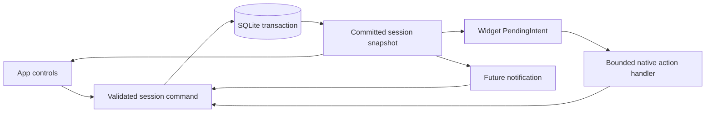

# Active-session widget research

Research date: 2026-10-25. Scope comes from CHECKLIST.md section 3.2b: control an
already-running workout from the Android home screen. Notification controls are
a separate research/build item. This document recommends an implementation;
no widget package, native receiver or production UI has been added or tested yet.

## Recommendation

Build a native Android App Widget with RemoteViews in a local Expo module and a
config plugin. Use native text, buttons and a Chronometer, with one shared,
transactional session-command layer behind the app, widget and future notification.
Reuse and validate the native session-notification action store now being developed
in this working tree. Prove cold-start command execution on SDK 58 / React Native
0.88 before building all controls. This choice follows the library-first review below: the available
wrappers have material limitations for a live clock plus durable workout writes.

Start with a resizable 4-by-2 control widget. Offer a compact 2-by-2 presentation
only if the actual launcher dimensions support readable content and adequate
controls. Cell counts describe placement, not a guaranteed pixel or dp size.
Android recommends adaptive size breakpoints and allows supplemental information
to disappear at smaller sizes. [Android sizing](https://developer.android.com/design/ui/mobile/guides/widgets/sizing)

## Platform and library findings

| Route                       | Verified capability                                                                     | Decision for Ironkeep                                                                                                  |
| --------------------------- | --------------------------------------------------------------------------------------- | ---------------------------------------------------------------------------------------------------------------------- |
| Expo Widgets                | SDK 58 has Android widgets, Expo UI layouts and snapshot updates                        | Useful for display; insufficient by itself for our closed-app database commands and ticking clock                      |
| react-native-android-widget | Expo integration, click tasks and a native Headless JS worker                           | Useful reference/alternative; bitmap layout and sizing limitations make it a poor default for this live control widget |
| Native Jetpack Glance       | Kotlin declarative widgets, callbacks and persisted state; rendered through RemoteViews | Valid alternative; the clock still needs a native RemoteViews solution                                                 |
| Native RemoteViews          | Standard Android widget controls and Chronometer                                        | Recommended for this small, fixed set of controls; more native integration work must be tested                         |

The previous checklist statement that Expo has no widget API is outdated. The
installed Expo compatibility map lists `expo-widgets` and `@expo/ui` at
`~58.0.23`; neither is currently installed. Expo's Android widgets require
`enableAndroid`, a rebuilt binary and Expo UI components. The isolated widget
function cannot use React hooks, app memory, async work or imports. Android uses
`updateSnapshot`; timelines and Live Activities are iOS-only. The documented
Android component set does not include Chronometer. [Expo Widgets](https://docs.expo.dev/versions/latest/sdk/widgets/)

There is also a consequential persistence distinction. In inspected SDK 58
source, a button evaluates against widget props, can store updated props in
private preferences, emits an interaction event, and redraws. The event dispatcher
calls an optional in-memory observer; it does not queue the event for a missing
app listener. Therefore changing the widget's displayed count is not evidence
that Ironkeep's SQLite workout was saved. This is a source-based inference, not
a device experiment. Do not implement Set done as a props increment plus an
app-only event listener. [Action implementation](https://github.com/expo/expo/blob/5b69ff347d00b149f912676e53e9a15767bdfc22/packages/expo-widgets/android/src/main/java/expo/modules/widgets/WidgetInteractionAction.kt),
[event dispatcher](https://github.com/expo/expo/blob/5b69ff347d00b149f912676e53e9a15767bdfc22/packages/expo-widgets/android/src/main/java/expo/modules/widgets/WidgetsEvents.kt),
[storage](https://github.com/expo/expo/blob/5b69ff347d00b149f912676e53e9a15767bdfc22/packages/expo-widgets/android/src/main/java/expo/modules/widgets/WidgetsStorage.kt).

The third-party library documents click tasks and Expo Router entry registration.
Its Android worker starts a Headless JS task with a 30-second timeout and allows
foreground execution. However, its documented renderer creates images and warns
about launcher size mismatches/cropping. Do not assume native clock semantics or
complete accessibility from a screenshot-shaped widget. Compatibility with this
project's RN 0.88, strict TypeScript and current Expo build is unproven.
[Task registration](https://saleksovski.github.io/react-native-android-widget/docs/tutorial/register-task-handler),
[renderer limitations](https://saleksovski.github.io/react-native-android-widget/docs/limitations),
[pinned worker source](https://github.com/sAleksovski/react-native-android-widget/blob/a06d9ed70d7a5073612fe3876282aecb7b701925/android/src/main/java/com/reactnativeandroidwidget/RNWidgetBackgroundTaskWorker.java).

Glance widgets live outside the activity's UI lifetime. The app must publish
updates when durable state changes; in-memory state is insufficient. Glance
supports activity, broadcast and callback actions. Activity opening should use a
direct activity action rather than a service/receiver trampoline.
[Glance state](https://developer.android.com/develop/ui/compose/glance/glance-app-widget),
[Glance actions](https://developer.android.com/develop/ui/compose/glance/user-interaction).

## Content and action contract (proposed)

Android's design guidance asks for one primary use case. Apple's guidance also
favours information density appropriate to each size; its interactive-widget
guidance distinguishes a real action from merely opening the app. Apply these
principles without adding an iOS target.
[Android widget design](https://developer.android.com/design/ui/mobile/guides/widgets),
[Apple widget design](https://developer.apple.com/design/human-interface-guidelines/widgets),
[Apple interactivity](https://developer.apple.com/documentation/widgetkit/adding-interactivity-to-widgets-and-live-activities).

| State                  | Content                                                                                                                  | Controls                                                                  |
| ---------------------- | ------------------------------------------------------------------------------------------------------------------------ | ------------------------------------------------------------------------- |
| Active                 | Day name, selected lift, Set 2 of 3, displayed load/reps or seconds, completed/total sets, time since last completed set | Set 2 done, Pause, Next lift; header opens this workout                   |
| Paused                 | Same factual content, clearly labelled Paused                                                                            | Resume; disable completion until resumed                                  |
| All sets logged        | Completed/total sets; no fabricated next set                                                                             | Open session for the existing finish/check-in flow                        |
| No active session      | Ironkeep and No active session                                                                                           | Whole widget opens Today; no start prompt, streak or recommendation       |
| Action pending / stale | Last committed data with pending control state; refresh stale state                                                      | Suppress repeated writes; offer opening the session if recovery is needed |

The resting widget stays on the launcher; finishing cannot remove a widget the
user placed. It switches to its quiet state. The future notification, unlike the
widget, should disappear on finish/discard.

The full layout has three controls. Compact mode prioritizes Set done and
Pause/Resume, with the header opening the exact session for other actions.
Next lift changes selection only: it never marks a skipped lift complete or
finishes the workout. Do not wrap from the last lift unexpectedly.

Set done records the exact displayed values using the existing completion rules.
Unknown weight must disable the action, as it does in the app. Weight/reps editing
and reps-left input open the matching set in the app; the widget does not invent
answers. Preserve an explicit Undo path in the app, and evaluate an Undo affordance
in the larger widget after completion. Do not put Finish or Discard on the widget.
Use current kg/lb formatting and all load types, including bodyweight and seconds.

Use theme tokens mapped to native resources, readable text and at least 48 dp
interaction targets as an implementation acceptance target. Test large fonts,
long exercise names, TalkBack labels and launcher resizing; reduce secondary
content before shrinking controls. Dynamic colour is optional, never required
for legibility. Actual canvas artboards and user review remain a build/design step.

## Clock and refresh policy

Use a host-rendered count-up Chronometer. RemoteViews supports setting its base,
format and running state; the base uses `SystemClock.elapsedRealtime()`.
This avoids a JavaScript timer that repeatedly rebuilds the widget.
[RemoteViews Chronometer](https://developer.android.com/reference/android/widget/RemoteViews#setChronometer(int,%20long,%20java.lang.String,%20boolean)),
[SystemClock](https://developer.android.com/reference/android/os/SystemClock).

Persist the last successful completion timestamp. On the same boot, use a
monotonic anchor; after reboot, reconstruct cautiously from the durable wall-clock
timestamp and never display a negative interval. Test clock/time-zone changes.
The existing session-duration calculation excludes pauses. Time since a set is
a separate elapsed interval: the proposed behaviour follows the current Zen
screen and keeps counting through a session pause. Label it unambiguously.
Before the first completed set, omit it. An undo must restore the previous real
completion anchor, not keep the undone set's time. Next lift does not reset it.

Set `updatePeriodMillis` to 0. Publish after committed session changes, placement,
resize, relevant configuration changes and recovery; do not schedule periodic
polling. Android's provider interval cannot run more often than 30 minutes,
whereas user-triggered updates can happen immediately. Receivers have a short
execution window, so cold database work belongs in bounded asynchronous handling.
[Android update guidance](https://developer.android.com/develop/ui/views/appwidgets/advanced).

The requested controls necessarily require brief user-triggered work when the
activity is closed. They do not justify an always-on service, network access,
per-second app work or periodic background jobs. A widget alone does not need a
notification permission prompt. Audit the generated manifest separately from the
later notification feature; retain the project's release permission checks.

## Changes required in our current code

The initial inspection found the following gaps. Notification integration changed
several of these files during research; the reconciliation immediately below is
the current implementation starting point:
- `use-session-persist.ts` debounces numeric edits for 500 ms and writes complete
  set arrays. Its flush is used by selected UI actions; it is not a cross-surface
  commit protocol. A late save could overwrite a widget completion.
- `repo.saveEntrySets` reads then replaces the workout's entries without a
  concurrency revision check. Adding a second writer makes that unsafe.
- `completeSet` is a toggle. Replaying it can undo a successful completion; widget
  commands must explicitly request done=true, with a separate undo command.
- `use-session-sets.ts` keeps the open exercise locally; Zen keeps its lift index,
  chosen set and last-completion time locally. A widget cannot reliably mirror
  those values after process death. Persist one agreed active-session cursor.
- `pauseWorkout` already accepts a desired paused state, but its read/write pair
  still needs the same transaction and concurrency discipline.

A later working-tree inspection found `modules/session-notification/` and
`session-write-queue.ts` under active development. `SessionStore.transact` already
opens the existing Expo SQLite file, uses a native transaction, checks a session
ID and state hash, and writes only an active session. `SessionState.apply` uses
explicit done=true and pause/resume actions. The new queue drains drafts on
backgrounding and gates native actions while writes are pending. These changes
address parts of the initial findings; they are not a completed widget or proof
of all race conditions.

Use this store as the first adapter to test, extracting shared names/interfaces
where needed. Do not add a second native workout writer. Remaining research-to-
build gaps include a durable selected-lift/set cursor, Next lift semantics,
last-completion timestamps, crash recovery, and contract tests between Kotlin's
value/completion logic and `lib/logic/sets.ts`. Verify all mutation paths use the
same write discipline. The existing content hash detects many stale actions,
but a durable revision/operation receipt is still the proposed protection against
replay after state changes and later returns to the same content (for example,
complete, undo, then delivery of the original tap).

Proposed shared command boundary:

Keep SQLite authoritative. Commands carry workout ID, exercise ID, set index,
expected control revision and operation ID. Index-based targets are valid only
against the matching revision, including after add/remove/reorder/swap. Reject
stale commands and refresh; never reinterpret an old tap as the new current set.
Use a unique operation receipt and a conditional revision update in the same
transaction. A completed workout rejects further mutation. Do not reuse
`historyRevision`, which serves historical-data normalization.

Apply app edits through this boundary too. Commit drafts before publishing an
actionable snapshot or leaving the foreground, reconcile pending saves, and
reload on external mutations/resume. Update every placed widget from the same
committed revision. UI optimism may show pending state, but only a successful
transaction increments the displayed saved progress. A failed publish must not
roll back or lose the saved workout; refresh it on the next lifecycle opportunity.

Use explicit immutable PendingIntents with distinct action/target identities and
validated payloads. Opening the app uses a direct activity PendingIntent.
[Android PendingIntent guidance](https://developer.android.com/privacy-and-security/risks/pending-intent).

Prefer the existing native notification store for cold-process widget actions,
with shared parity fixtures proving its results match the TypeScript rules.
The native store must not create an empty database or run competing migrations;
first-run/migration-required states open the app to initialize safely.
Headless JS remains a fallback to investigate only if native rule parity or
integration cannot be maintained. React Native documents bounded asynchronous
headless tasks, but this exact Expo SQLite/runtime combination is not verified.
A headless adapter also needs a manifest and wake-lock audit against the
no-extra-permission constraint. A props-only counter is not a valid fallback.
[React Native Headless JS](https://reactnative.dev/docs/headless-js-android).

## Build sequence and acceptance gates

1. Isolated feasibility spike: render native text and count-up clock; dispatch a
   user action with the activity backgrounded and after ordinary process death;
   reuse the native notification store, refuse an uninitialized/migrating database,
   and commit exactly one synthetic set with TypeScript/Kotlin parity. Use a
   separate test package. No production data export or replacement.
2. Add the shared command/cursor/revision model and regression tests before
   connecting completion buttons. Cover competing app edits, two widgets,
   duplicate delivery, stale set indices, pause races and finish/discard races.
3. Create light/dark widget canvas boards for active, paused, completed and idle
   states; implement responsive native layouts and all load types.
4. Verify on the Pixel 6a and an older supported Android API: add/remove, resize,
   large fonts, TalkBack, multi-instance actions, rotation/configuration changes,
   app swiped away, ordinary process kill, reboot, update, backup restore and
   data reset. Distinguish force-stop from normal process death; do not promise
   Android will execute background actions while the package is force-stopped.
5. Verify the actual launcher-size breakpoints plus 360/412 dp light/dark app
   transitions, a release build without Metro, permissions and measured APK size
   delta. Size is informational under the user's current release policy.
6. Verify no recurring jobs or ongoing service were introduced for the widget;
   inspect behaviour while idle and over a real session. Keep captures in the
   Git-ignored `e2e/screenshots/session-widget/` folder.

Research and the first interactive prototype are complete. The original research
was recorded before notification implementation. Current device evidence and the
remaining release gates are in `docs/testing/session-widget.md`.

## Prototype scope accepted 2026-10-25

The first build adds weight and reps/seconds steppers, a session-only extra set,
Set done, and Pause/Resume. It follows the notification's first unfinished set;
manual Next lift/cursor selection remains a later interaction, not an implicit
completion. Adding a set never changes the saved plan. Completed sessions open
in the app for review. The launcher follows the system light/dark scheme.

Both surfaces use the existing native module and the same SQLite transaction in
`:session_controls`. The app holds a cross-process file lock while saving drafts;
after commit it requests a refresh. Android SQLite is never loaded in Expo's
process. A per-snapshot random receipt is stored in local `prefs` in the same
transaction and combined with the content fingerprint. Replayed commands are
rejected even after observed edits restore the original numbers. Restore deletes
receipts; backups neither export nor import them. This is a single-use snapshot
token, not an independent operation log or a new workout schema.

The native count-up clock is anchored to observed transitions to completed sets.
Initial/imported completed sets have no invented timestamp. Undo removes its
anchor and reveals the preceding known completion. The clock counts wall time
since the set, including time while paused, and Android draws each tick. Refresh
is event-driven, with `updatePeriodMillis=0` and no service or recurring job.

The native resources derive colours from `src/global.css` at build time. Typography uses native sans-serif and condensed faces: launcher
RemoteViews do not reliably load the app's custom font resources. No widget library or production dependency was added.
Shared JSON completion fixtures run in both Jest and Robolectric. Device evidence
and remaining gates are recorded in `docs/testing/session-widget.md`.

Launcher sizing check: a fixed 340 dp minimum resize height caused Pixel Launcher
to filter out the widget, because minimums must fit its landscape cell sizes too.
The provider now allows a compact size and publishes native responsive layouts:
250 x 220 dp at normal text size for controls, 180 x 80 dp for a compact open-session card. This follows
[Android's responsive widget sizing guidance](https://developer.android.com/develop/ui/views/appwidgets/layouts).

The final provider requests 4 x 1 cells and permits a 48 dp resize height, with a
48 dp landscape strip below the compact-card threshold. Pixel Launcher confirmed
one-row placement and shrinking back from three rows. Font-aware compact/full
thresholds are paired with resolved text dimensions so a host cannot enlarge text
inside an old cached layout. A live component callback requests an event-driven
refresh; a stopped process adopts the new scale at its next widget/app event.
See Android's [RemoteViews text sizing](https://developer.android.com/reference/android/widget/RemoteViews#setTextViewTextSize(int,%20int,%20float))
and [configuration callbacks](https://developer.android.com/reference/android/content/ComponentCallbacks).
